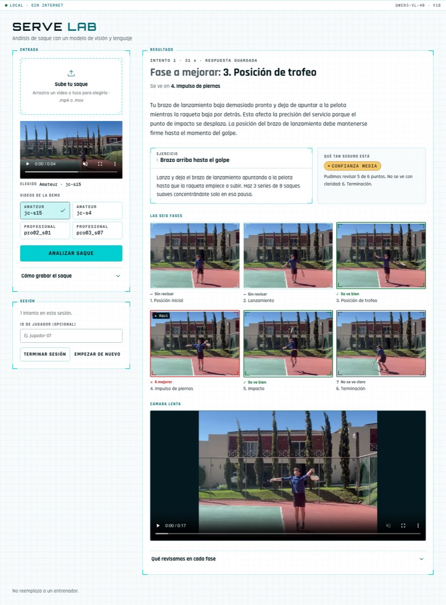

# Serve Lab

Interactive assistant that analyzes the **tennis serve** from a short video. It splits the motion into phases, finds the phase with the main opportunity for improvement, shows the frames that support the observation, and suggests a drill. It keeps a history of sessions to follow the player's progress.

Project 3 of CC3092 Deep Learning y Sistemas Inteligentes (UVG). Only a vision-language model looks at the video: there is no pose model and there are no measurements. Full proposal: [docs/proposal.md](docs/proposal.md). The Final Project, which adds pose estimation, lives on the `proyecto-final` branch.

## Summary of the work

The model (Qwen3-VL-4B, 4-bit, on the Mac) is never trained: the work is in the prompts and in the code around them, across prompt versions v4 to v22. They were measured on 31 serves filmed from the side: 20 of JC, an amateur whose tossing arm drops early, and 11 of three professionals with no clear problem. Claude labeled them as an LLM judge; the team's own labels are not compared yet. Each version fixed a failure seen in the runs:

- **v5 to v7:** the answer followed the order of the options. Then the model never said "no". Then it flagged every professional.
- **v8:** two opposite questions that must agree, and a crop around the player.
- **v9:** a close second look at the contact frame.
- **v13 and v17:** code places the leg drive 0.1 s before contact and the landing 0.6 s after it.
- **v18 and v22:** more tries when the phases look guessed.
- **v20 and v21:** the tossing arm. The model described JC's arm as "extended outward" but answered "above the head", because it looked at the racket hand. v20 makes it find the racket hand first and asks which way the other arm points. v21 counts a diagonal closer to horizontal as a drop.

The web page was also rebuilt in React with The Gridcn components; the earlier Gradio app is kept as a fallback.

### Results

Over sampling seeds 0 to 3, 4 runs per version (from `uv run python -m experiments.seeds`):

| Version | Change | Macro-F1 | JC drops found (of 80) | Professional false alarms (of 44) | Videos with no answer (of 128) |
| --- | --- | --- | --- | --- | --- |
| v12 | neutral question about the upper body | 0.210 ± 0.052 | 8 | 3 | 6 |
| v17 | landing placed 0.6 s after contact | 0.336 ± 0.168 | 15 | 2 | 6 |
| v18 | third try when the phases look guessed | 0.372 ± 0.144 | 16 | 2 | 2 |
| v19 | majority of three answers (not adopted) | 0.319 ± 0.084 | 10 | 2 | 2 |
| v20 | which way the tossing arm points | 0.652 ± 0.178 | 58 | 4 | 2 |
| v21 | a diagonal closer to horizontal is a drop | 0.714 ± 0.233 | 66 | 3 | 2 |
| **v22** | **fourth try (default)** | **0.842 ± 0.084** | **67** | **3** | **0** |

- **Baselines:** the simple prompt and the 2B model flag all 11 professionals and score 0.00 (seed 0).
- **What v22 still gets wrong:**
  - its 3 false alarms all come from one serve, pro03_s03, whose contact frame is placed late;
  - 13 of JC's 80 drops are still missed.
- **Speed:** one analysis takes about 36 s on the Mac.

### How decisions were made

- **Versions are files.** A version is never edited once it has results. Its header (`strokes/serve/prompts/v*.yaml`) says what changed, why, and what came out. Every run is a row of `experiments/iterations.csv`.
- **Versions are compared on 4 seeds.** The model samples its answers. Changing the seed moved the contact frame by up to 18 frames and changed answers about the same frame. So versions are compared on the mean over seeds 0 to 3, and on the dev and test halves separately.
- **A cheap test comes first.** An idea is tried first on saved frames (`experiments/probe_toss_arm.py cached`, about 3 minutes). Only then does it get a full run: about 80 minutes for 4 seeds.
- **The adoption rule.** A version becomes the default only when all of these hold:
  - its mean macro-F1 is higher;
  - its test half is no worse;
  - on professionals, it gives 0 false alarms with seed 0 and at most 2 of 44 in all;
  - it takes at most 45 s per JC video;
  - the tests pass;
  - the app still asks for a new recording on the bad demo video.
- **How the rule was applied:**
  - v19 varied less between seeds but scored lower, so v18 stayed.
  - v20 broke the false alarm limit (4 of 44), but it raised the mean macro-F1 from 0.372 to 0.652. The team chose to adopt it for its recall, and the exception is written in its header.
  - v21 and v22 each beat the version before on every measure.
- **v22 was measured without a full run.** Its extra try runs only after three guesses, so on every other video it makes exactly v21's calls. Only the two videos where v21 gave no answer were run again; `experiments/seeds.py` scores v21's runs with those two videos replaced.

## Requirements

- macOS on Apple Silicon (developed on a Mac M5 Pro, 24 GB).
- [uv](https://docs.astral.sh/uv/). It installs Python 3.12 automatically if needed.
- [Node.js](https://nodejs.org/) 20 or later, only to build the web page once.

## Installation

```bash
uv sync                  # install
cp .env.example .env     # optional settings
cd web && npm install && npm run build && cd ..   # build the web page into web/dist
```

The first run downloads Qwen3-VL-4B (about 3 GB) into the Hugging Face cache. After that, everything runs offline on the Mac.

## Usage

```bash
uv run python -m app.api     # web app at http://127.0.0.1:7860
```

The page is a React app in `web/` (components from [The Gridcn](https://thegridcn.com), how to build and change it in [web/README.md](web/README.md)), served with its API by `app/api.py`. `uv run python -m app` starts the earlier Gradio version instead, kept as a fallback: it gives the same answers.

How one video is analyzed (prompt v22):

1. OpenCV checks the video (frame rate, length) and takes 32 evenly spaced frames.
2. The model draws a box around the player on the first, middle and last frames. The box is joined, grown to the reach of a serve (toss, racket, landing), and every frame is decoded again cropped to it, so a player far from the camera fills the frame. No crop when it would keep most of the frame.
3. The model decides whether the video can be analyzed and where the serve starts and ends. Players bounce the ball before serving, so most of a video is not the serve.
4. OpenCV takes 32 frames again, only inside the serve, and the model picks the frame that best shows each of the six phases. Each frame has its number drawn on it. When the answer is six frames in a row (the model counted instead of looking), it tries again on every 2nd frame, then on every 3rd, then on every 4th. Contact lasts a few hundredths of a second, so the model then looks again at 12 frames sampled closely between the key frames before and after it. The end of the leg drive and the landing are placed by code, 0.1 s before and 0.6 s after contact: the model did not find them among close frames (the landing it picked with the player still in the air), and at 0.1 s before contact a dropped tossing arm shows best.
5. Two yes / no / unclear questions per category, each about one key frame: its phase's, or the one that shows it better (the tossing arm is judged at the trophy and at the end of the leg drive): one about the good position (`check` in `strokes/serve/criteria.yaml`) and one about the problem (`problem`). A check counts only when both agree; otherwise it is "unclear". The early drop of the tossing arm is asked differently: one neutral question (which way the tossing arm points, after finding the racket hand: straight up, a diagonal closer to vertical or to horizontal, horizontal, down) about the upper body only, cropped from a box the model draws and enlarged, because with yes / no the model agreed with whatever the question described. The earliest phase with an agreed problem is the point to improve, with its drill; with none, the answer is "no clear problem". One more call writes the observation, only about that point.

Every answer is JSON constrained by a schema, so the model can only choose known frames, phases, categories, and drills. Why each step exists is in the header of each prompt version, `strokes/serve/prompts/v*.yaml`.

In the app, upload one serve recorded from the side, following [docs/grabacion.md](docs/grabacion.md) (recording guide, in Spanish), or pick a demo video, and press "Analizar saque". Progress is shown in four numbered steps. The app shows:

- the phase with the main opportunity for improvement (and the phase whose frame shows it), the observation and a drill,
- how far to trust it ("Qué tan seguro está"): the confidence and how many checks the model could judge,
- the key frame of each of the six phases with its verdict in words and color: se ve bien (green), a mejorar (red), no se ve claro (grey), sin revisar; "★ Aquí" marks the frame the observation talks about. A frame opens large when tapped,
- the video in slow motion with the current phase,
- every check with what the model saw ("Qué revisamos en cada fase"),
- from the second attempt on, a comparison with the previous attempt.



"Terminar sesión" summarizes the session and proposes the focus of the next practice. With a player ID, the session is added to that player's history in `data/history/`. "Empezar de nuevo" clears the video, the answers and the session for the next player.

If the video cannot be analyzed (wrong angle, player out of frame, too dark, too short or too long, low frame rate, not a video), the app shows the reason and the recording tips instead of feedback. If the model gives no valid answer, the app says so and asks to try again. The page bundles its fonts and loads nothing from the internet, so it works offline.

### Demo mode (fair)

One analysis takes 15 to 45 s on the Mac. For the fair, put the demo videos in `data/demo/` (only players with `consent_image` = `yes`; include one bad recording to show the request for a new one) and run:

```bash
uv run python -m app.api --demo
```

At start, each video in `data/demo/` is analyzed once; the answer is saved in `data/processed/demo_cache/` and shown at once after that, marked "respuesta guardada". The videos appear under "Videos de la demo". Any other video, such as a visitor's, is analyzed live and its answer is not saved. A saved answer is reused only for the same video, model, prompt version and criteria version; delete `data/processed/demo_cache/` to analyze again.

## Evaluation

The labels written by the team are only the answer key: in Project 3 the model is not trained, it is used as downloaded with a prompt. See [what the labels are for](data/README.md#what-the-labels-are-for).

1. Put the videos in `data/raw/`. There is no coach: both members label each serve on their own, compare, and write the agreed labels in `eval/serve/labels.csv` (guide in [data/README.md](data/README.md)):

```bash
uv run python -m eval.label      # labeling tool, http://127.0.0.1:7861
uv run python -m eval.run_eval --agreement eval/serve/labels_ernesto.csv eval/serve/labels_hugo.csv
```

2. Run the full system and the two baselines:

```bash
uv run python -m eval.run_eval --variant full   --note "v4 prompt"
uv run python -m eval.run_eval --variant simple --note "baseline: frames only, no criteria"
uv run python -m eval.run_eval --model mlx-community/Qwen3-VL-2B-Instruct-4bit --note "baseline: smaller model"
```

Each run saves its predictions in `eval/serve/runs/` and appends a row to `experiments/iterations.csv`: phase accuracy, category F1, hallucination rate, correct re-recording requests, latency, tokens (every call), and peak memory. For the simple baseline the hallucination rate is an automatic proxy (the category belongs to another phase). For the full system the code chooses the category, so the rate comes from the members' review of each check next to its frame (tab "Revisar respuestas" of the labeling tool):

```bash
uv run python -m eval.run_eval --review eval/serve/runs/<run>.jsonl eval/serve/review_*.csv
```

Runs made before the labels existed (`--videos`) are scored afterwards against any label file, one system's runs together (JC and professionals):

```bash
uv run python -m eval.run_eval --score eval/serve/runs/<jc run>.jsonl eval/serve/runs/<pro run>.jsonl --labels eval/serve/labels.csv
```

The model samples its answers (temperature 0.2, `seed` in `configs/default.yaml`), so a run with another seed (`--seed`) can give other answers: the contact frame moves a few frames and an answer about the same frame can flip. One seed is not enough to compare two versions; compare the mean over several seeds:

```bash
uv run python -m experiments.seeds   # macro-F1 per prompt version and seed
```

With seeds 0 to 3, v22 has macro-F1 0.842 ± 0.084 and no video without an answer (128 analyses), v21 0.714 ± 0.233, v20 0.652 ± 0.178, v18 0.372 ± 0.144, v17 0.336 ± 0.168 and v12 0.210 ± 0.052. v21 finds JC's early tossing-arm drop on 66 of 80 serves (v20 58, v18 16) and gives 3 false alarms on 44 professional serves (v20 4, v18 2), all on one serve whose contact frame is placed late. Greedy decoding (`--temperature 0`) gives the same answers for every seed but scored lower (0.115 with v17).

Cost per analysis: the model runs on the Mac, so there is no API cost. Energy is not measured; as an estimate, about 30 s at an assumed 40 to 60 W is 0.3 to 0.5 Wh, a small fraction of a cent.

Settings that change results (number of frames, language model, prompt version, temperature) are in `configs/default.yaml`. Change one at a time and run the evaluation again.

## Privacy

- Videos and player histories stay in ignored folders under `data/`. Nothing is uploaded: the app listens only on `127.0.0.1`, and the Gradio fallback has its analytics disabled.

## Tests

```bash
uv run pytest
```

## Repository layout

```
configs/      shared settings (frames, model, generation parameters)
core/         code shared by all analyses: video, frames, llm, history
strokes/      one module per stroke; serve/ is the current prototype
app/          API and shared analysis (api.py, service.py), Gradio fallback (__main__.py)
web/          web page (React), served by app/api.py
data/         videos (not in Git) and annotations, see data/README.md
eval/         evaluation sets and metric scripts, per stroke
experiments/  iteration log (iterations.csv)
docs/         proposal, licenses, images
tests/        automated checks
```

Rules that keep the repository scalable:

- `core/` contains no stroke-specific logic. `tests/test_architecture.py` fails if `core/` imports `strokes`.
- Each stroke lives in its own folder under `strokes/` with the same structure.
- Criteria, drills, and prompts are versioned files, not hard-coded strings.
- Each stroke has its own evaluation set under `eval/`.

## Licenses

Third-party models, libraries, and datasets: [docs/licenses.md](docs/licenses.md). The project code has no license yet (all rights reserved).
