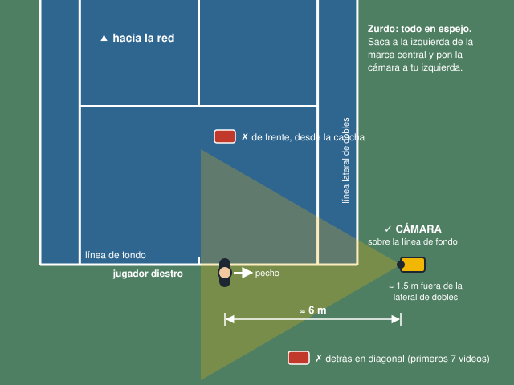
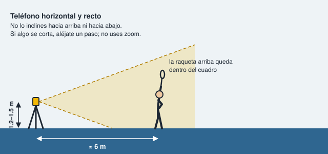
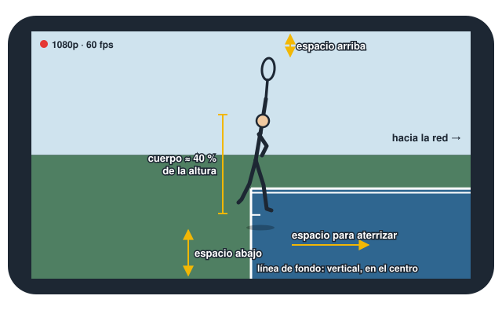
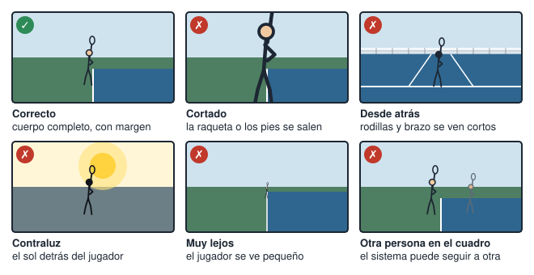

# Cómo grabar los saques

Serve Lab mide tu saque a partir del video: encuentra tus articulaciones en cada cuadro, divide el saque en fases y compara lo que ve con los criterios. Si la grabación es mala, mide mal o te pide repetir. Esta guía fija una sola forma de grabar para que todos los videos se puedan comparar entre sí.

**Regla principal:** graba todos los videos con la misma configuración. Un video bien grabado pero distinto a los demás también arruina la comparación.

## Lista rápida

Revísala cada vez, antes de empezar a grabar.

- [ ] Teléfono **horizontal**, en trípode o apoyado firme, a **1.2–1.5 m** de altura (pecho), recto.
- [ ] Cámara **del lado de tu pecho**, sobre la prolongación de la línea de fondo, a **unos 6 m** de ti.
- [ ] Lente **1x**: sin gran angular (0.5x) y sin zoom.
- [ ] Video normal a **1080p y 60 fps**. Sin cámara lenta, modo cinematográfico ni modo acción.
- [ ] Prueba de encuadre: con la raqueta estirada hacia arriba, queda espacio sobre la raqueta y bajo los pies.
- [ ] Luz de día, **sin el sol detrás de ti**. Nadie más dentro del cuadro.
- [ ] **Un saque por video**, de 4 a 8 segundos.
- [ ] Envía el **archivo original** (AirDrop, Google Drive o cable), no por WhatsApp.

## 1. Dónde poner la cámara

- **Diestro:** saca desde la derecha de la marca central (lado de iguales). Pon la cámara a tu derecha, sobre la prolongación de la línea de fondo, unos 1.5 m por fuera de la línea lateral de dobles. Quedará a unos 6 m de ti.
- **Zurdo:** todo en espejo. Saca desde la izquierda de la marca central y pon la cámara a tu izquierda.
- Al empezar el saque estás de perfil a la red, así que tu pecho mira hacia la cámara. Durante el saque giras y terminas mirando a la red.

**Por qué de lado.** Desde aquí la cámara ve los dos brazos, el lanzamiento, la flexión de rodillas y la extensión del brazo en el impacto. Los primeros 7 videos se grabaron desde atrás en diagonal. En ese ángulo las rodillas y el brazo se mueven hacia la red, lejos del lente, y se ven más cortos de lo que son. Por eso hubo que quitar esas mediciones.

**Comprobación de alineación.** Mira la pantalla: la línea de fondo debe verse como una línea casi vertical cerca del centro (imagen de la sección 2). Si se ve inclinada o cruzando la pantalla de lado a lado, mueve la cámara hasta que quede sobre la línea.

## 2. Altura y encuadre

- **Altura:** a la altura de tu pecho, entre 1.2 y 1.5 m. Sirve un trípode, una mochila sobre la banca o un soporte en la reja.
- **Recto:** el teléfono no se inclina hacia arriba ni hacia abajo. Si la raqueta se corta, aléjate un paso en lugar de inclinarlo o usar zoom.
- **Horizontal:** deja espacio para lanzar hacia arriba y para aterrizar dentro de la cancha.

Así debe verse la pantalla:

**Prueba de encuadre.** Antes de grabar, ponte en tu posición y estira el brazo con la raqueta hacia arriba, como en el impacto. Revisa estos cuatro puntos:

1. Sobre la punta de la raqueta queda espacio.
2. Bajo los pies queda espacio.
3. Hacia la red queda espacio para aterrizar, más o menos un tercio de la pantalla.
4. De pie, tu cuerpo ocupa cerca del 40 % de la altura de la pantalla. Si ocupa mucho menos, acércate un paso.

## 3. Configuración del teléfono

| | iPhone | Android |
| --- | --- | --- |
| Resolución y velocidad | Ajustes > Cámara > Grabar video > **1080p HD a 60 cps** | Cámara > Video > ajustes: **FHD 1080p, 60 fps** (el nombre cambia según la marca) |
| Modo de grabación | **Video** (no Cámara lenta, no Cinematográfico) | **Video** (no cámara lenta, no modo pro con filtros) |
| Lente | **1x** | **1x** |
| Fijar luz y enfoque | Mantén el dedo sobre ti en la pantalla hasta que aparezca **BLOQUEO AE/AF** | Mantén el dedo sobre ti hasta que se bloquee el enfoque, si tu teléfono lo permite |
| Desactivar | Modo acción (recorta la imagen), filtros, zoom | Estabilización extrema, filtros, zoom |

**Por qué 60 fps.** El brazo de la raqueta es lo más rápido del saque. A 30 fps pasan 33 ms entre cuadros: la muñeca avanza mucho de un cuadro al siguiente y sale borrosa justo en el impacto, como ocurrió en los primeros videos. A 60 fps pasan 17 ms y el impacto queda mejor marcado.

**Límites del sistema:** rechaza videos con menos de 24 fps, de menos de 1 segundo o de más de 20 segundos.

## 4. Cómo grabar cada saque

1. Empieza a grabar y espera 1 o 2 segundos quieto en tu posición.
2. Haz tu rutina corta: uno o dos botes como mucho.
3. Saca con tu velocidad normal de partido.
4. Después de aterrizar, quédate en el cuadro 2 segundos.
5. Detén la grabación. Cada video dura de 4 a 8 segundos y contiene **un solo saque**.

- Usa siempre el mismo tipo de saque en una sesión (plano, liftado o cortado). Si cambias, anótalo.
- Ropa ajustada que contraste con el fondo. Ropa suelta tapa codos y rodillas.
- Gorra y lentes de sol están bien. La cara no tiene que verse con detalle, pero la cabeza sí.

## 5. Luz y fondo

- **Luz:** de día o en cancha bien iluminada. Evita el atardecer, cuando la imagen se oscurece y aparece ruido.
- **Sol:** que no quede detrás de ti, frente al lente. Lo mejor es tener el sol detrás o al lado de la cámara.
- **Fondo:** nadie más dentro del cuadro. Si en la cancha de atrás hay gente jugando, cambia de cancha o de horario. Con dos personas en la imagen, el sistema puede seguir a la equivocada.

## 6. Errores comunes

| Error | Qué pasa | Qué dice la app |
| --- | --- | --- |
| La raqueta o los pies se salen del cuadro | Faltan articulaciones; el impacto no se encuentra | "El cuerpo se ve poco…" o "No se detecta el impacto por encima de la cabeza." |
| Grabado desde atrás o de frente | Rodillas y brazo se ven más cortos de lo que son | Ninguno: el sistema no detecta el ángulo y mide mal. Por eso esta regla es tan importante. |
| Contraluz o poca luz | La pose se detecta con poca confianza | "El cuerpo se ve poco: revisa la luz, la distancia y el ángulo de la cámara." |
| Muy lejos | Pocas imágenes del jugador; la pose tiembla | Puede pedir repetir o medir con más error |
| Otra persona en el cuadro | El sistema puede seguir a la otra persona | Resultados sin sentido |
| El video se corta en el impacto | Falta la terminación | "El video termina en el impacto; graba hasta la terminación." |
| El video empieza tarde | Falta el lanzamiento | "El video empieza en el impacto; graba desde la posición inicial." |
| Teléfono vertical o inclinado | Poco espacio para aterrizar; las medidas cambian | Ninguno |

## 7. Cuántos videos y de quién

El proyecto necesita un conjunto de evaluación de **30 a 50 saques**.

- **Jugadores:** idealmente de 3 a 5 jugadores distintos, de 6 a 10 saques cada uno. Al menos uno no debe aparecer en los videos de desarrollo.
- **Consentimiento:** cada jugador firma su consentimiento antes de grabarlo. Anótalo en `data/annotations/players.csv` con un ID anónimo (`p01`, `p02`…), su mano dominante y su nivel. Las reglas están en [data/README.md](../data/README.md).
- **Videos inválidos a propósito:** agrega de 4 a 6 videos mal grabados (cortado, desde atrás, oscuro, sin saque). Sirven para medir si el sistema pide repetir cuando debe. En las etiquetas van con `valid = 0`.
- **Desarrollo y evaluación separados:** los primeros 7 videos y los de prueba son de desarrollo. Los de evaluación no se usan para ajustar el sistema, y se etiquetan antes de ver lo que responde el sistema ([guía de etiquetado](../data/README.md#labeling-guide)).

## 8. Nombres y envío

- **Nombre del archivo:** ID del jugador y número de saque, por ejemplo `p01_s01.MOV`, `p01_s02.MOV`. Nunca el nombre real.
- **Envío:** el archivo original por AirDrop, Google Drive con acceso restringido o cable. No como video de WhatsApp. Los primeros videos llegaron a 576×1024, que no es una resolución de cámara: se recomprimieron al enviarlos.
- **Destino:** `data/raw/`. Esa carpeta nunca se sube a Git.

## 9. Prueba antes de grabar todo

Antes de grabar los 30 a 50 saques:

1. Graba 3 saques con esta configuración.
2. Envíalos y revisamos que las fases y las mediciones salgan bien.
3. Si algo falla, se ajusta esta guía y luego se graba el resto, todo igual.
