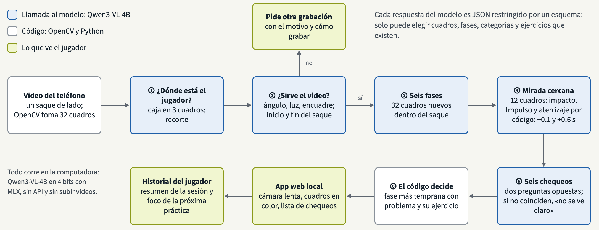
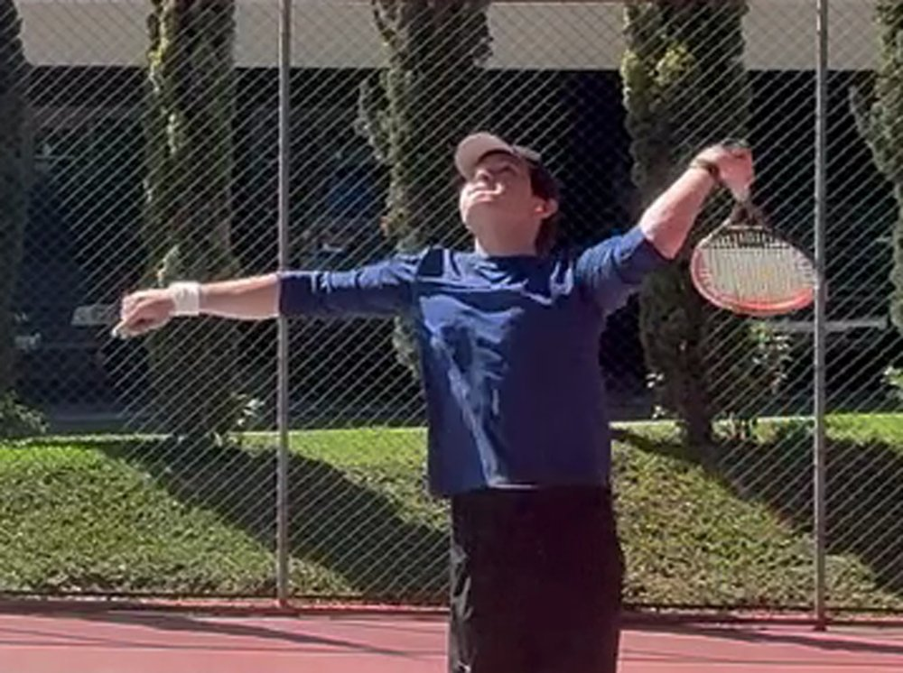
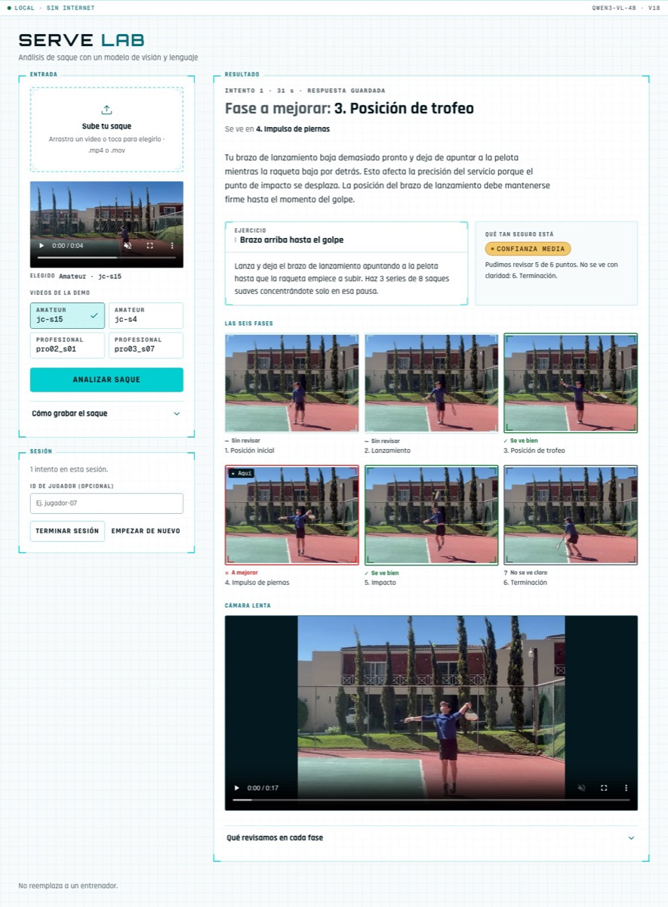

<!-- PDF (docs/informe.pdf), from the repository root:
pandoc docs/informe.md -s --embed-resources --resource-path=docs --css docs/informe.css --metadata pagetitle="Serve Lab: informe escrito" -o /tmp/informe.html
"/Applications/Brave Browser.app/Contents/MacOS/Brave Browser" --headless --no-pdf-header-footer --print-to-pdf=docs/informe.pdf /tmp/informe.html
-->

Universidad del Valle de Guatemala

Facultad de Ingeniería

CC3092 Deep Learning y Sistemas Inteligentes

Serve Lab: análisis del saque de tenis con un modelo de visión y lenguaje

Proyecto 3: Casos de Uso de LLM

Informe escrito

Ernesto David Ascencio Ramírez, 23009

Hugo Daniel Barillas Ajín, 23556

Guatemala, 6 de noviembre de 2026

## 2.1 Definición del problema y usuario objetivo

Un jugador amateur que entrena solo no tiene quién le diga qué corregir en su saque. Serve Lab recibe un video del saque, grabado de lado con el teléfono, y devuelve **un solo punto a mejorar**, los cuadros que lo muestran y un ejercicio. También compara intentos y resume la sesión. Se eligió el saque porque es el único golpe que el jugador controla por completo: no depende de la pelota del rival.

Un modelo de visión y lenguaje puede mirar los cuadros, responder preguntas sobre el cuerpo y escribir la observación en español sin datos de entrenamiento. Las alternativas no servían: con 39 videos no alcanza para entrenar un clasificador, y la estimación de pose con reglas fijas no es un producto de LLM (pasó al Proyecto Final).

**Criterio de éxito:** una corrección equivocada es peor que una omitida. Si el modelo no ve algo con claridad, debe decirlo. Se mide el macro-F1, las falsas alarmas en saques profesionales, los problemas detectados, los videos sin respuesta y la latencia, con un máximo de 45 s.

## 2.2 Datos y pipeline del sistema

Son 39 videos propios, grabados de lado:

- **28 de JC**, un amateur cuyo brazo de lanzamiento baja antes de tiempo. 20 se pueden analizar; los otros 8 están grabados de espaldas, en diagonal o incompletos, y el sistema debe pedir otra grabación.
- **11 de tres profesionales**, sin un problema claro.

Los videos no se publican, y solo JC autorizó usar su imagen.

No hay RAG: el modelo recibe cuadros, no documentos. OpenCV toma 32 cuadros numerados. El modelo ubica al jugador para recortar el video, decide si el video sirve y dónde está el saque, y después se toman 32 cuadros nuevos solo dentro del saque.

Un análisis usa unos 29 000 tokens, repartidos en llamadas pequeñas. El modelo nunca ve el video completo: los cuadros para ubicar las fases van a 512 px (unos 150 tokens cada uno), y solo los que se juzgan van a 1 024 px.

## 2.3 Selección del modelo y técnica de adaptación

El modelo es **Qwen3-VL-4B-Instruct**, en 4 bits, con MLX, en una Mac M5 Pro de 24 GB. Es abierto, denso y en versión *instruct*, tiene licencia Apache-2.0, pesa unos 3 GB y lee varias imágenes por solicitud.

Con el mismo prompt se probaron tres tamaños:

- **2B:** marcó problemas a 9 de 11 profesionales (macro-F1 0.05).
- **8B:** tardó 48 s por video y no fue mejor (0.14).
- **4B:** sacó 0.57, sin falsas alarmas, en 30 s.

Otros modelos se descartaron por su licencia: Qwen2.5-VL, Gemma 3 y Llama 3.2 Vision.

**Por qué abierto y local, y no GPT, Claude o Gemini:**

- Los videos de personas no salen de la computadora.
- Funciona sin internet en la feria.
- Cuesta $0 por análisis.
- El modelo no cambia entre una corrida y otra.

Lo que se pierde: un modelo cerrado grande quizá vería mejor los ángulos finos, pero no se midió. Los pesos se descargan de Hugging Face la primera vez; no van en el repositorio.

**Técnica: prompting *zero-shot*.** Es transferencia de aprendizaje a gran escala: el modelo resuelve la tarea solo con instrucciones, sin ajustar sus pesos. Tiene tres apoyos:

- **JSON restringido por un esquema:** el modelo solo puede elegir cuadros, fases, categorías y ejercicios que existen.
- **Varias llamadas pequeñas:** jugador, ventana, fases, impacto, chequeos, observación y resumen. El código decide lo que el modelo hacía mal.
- **Dos preguntas opuestas que deben coincidir.** Para el brazo de lanzamiento se usa una pregunta neutral con opciones.

Los parámetros de generación son temperature 0.2, top_p 0.9 y max_tokens 600. No hubo ajuste fino: 31 videos analizables son muy pocos.

## 2.4 Evaluación y medición de respuestas

El conjunto de evaluación son los 39 videos. Las respuestas de referencia son de Claude, como juez (*LLM as a judge*): miró 20 cuadros alrededor del impacto de cada video. **Falta validarlas con las etiquetas del equipo (κ de Cohen).**

La métrica principal es el **macro-F1** de la categoría a mejorar, de 0 a 1. Un video sin respuesta cuenta como error. Se reporta la media de 4 semillas, porque al cambiar la semilla el cuadro del impacto se movió hasta 18 cuadros.

También se miden las falsas alarmas en profesionales, las caídas de JC detectadas, la latencia, los tokens y la memoria. Líneas base:

- El prompt simple y el modelo 2B sacan 0.00.
- Responder siempre lo mismo saca 0.39 o 0.26.

## 2.5 Resultados de iteraciones

Cada versión de prompt corrigió una falla vista en las corridas. Media de las semillas 0 a 3:

| Versión | Qué cambió | Macro-F1 | Caídas de JC detectadas (de 80) | Falsas alarmas (de 44) |
| --- | --- | --- | --- | --- |
| v12 | pregunta neutral sobre el torso | 0.21 | 8 | 3 |
| v18 | tercer intento si adivina las fases | 0.37 | 16 | 2 |
| v20 | hacia dónde apunta el brazo | 0.65 | 58 | 4 |
| v21 | diagonal casi horizontal es caída | 0.71 | 66 | 3 |
| **v22** | **cuarto intento** | **0.84** | **67** | **3** |

**Qué falló y qué cambiamos:**

1. **v5 a v7: la redacción decidía la respuesta.** El modelo nunca dijo «no» (0 de 114) y luego marcó a los 11 profesionales. En v8 se pasó a dos preguntas opuestas que deben coincidir.
2. **Fases adivinadas.** El modelo devolvía seis cuadros seguidos. Se agregaron un recorte al jugador y nuevos intentos. Los videos sin respuesta bajaron de 6 a 0.
3. **Impacto mal ubicado.** En v9, una segunda mirada a 12 cuadros cercanos lo ubicó bien en 16 de 18 videos (antes 12).
4. **Fallas inventadas.** En v16, la observación pasó a hablar solo del punto a mejorar. Las fallas inventadas bajaron de 4 a 1 de 7.
5. **El brazo equivocado.** Es la falla de la figura.

{width=32%}

Con v18, el modelo describía el brazo como «extendido hacia afuera», pero respondía «arriba de la cabeza»: miraba la mano de la raqueta. v20 le pide ubicar primero la raqueta y decir hacia dónde apunta el otro brazo. La caída se vio en 58 de 80 saques (antes 16).

## 2.6 Producto final y experiencia de usuario

La app web corre en la misma Mac. El jugador sube su saque y pulsa «Analizar saque»; el progreso se muestra en cuatro pasos y el análisis tarda unos 44 s. La app muestra:

- la fase a mejorar, la observación y el ejercicio;
- los cuadros de las seis fases con su veredicto;
- el video en cámara lenta.

**Cómo comunica la incertidumbre:**

- Cada fase dice «se ve bien», «a mejorar» o «no se ve claro», con borde verde, rojo o gris.
- La app dice cuántos puntos pudo revisar («Pudimos revisar 5 de 6 puntos») y la confianza.
- Si no confirma nada, responde «sin problema claro».
- Si el video no sirve, explica el motivo y cómo grabar de nuevo.

## 2.7 Limitaciones, riesgos y consideraciones éticas

**Limitaciones:**

- **Las referencias son de un solo juez (Claude)** y no se han comparado con las del equipo.
- **La tarea es casi binaria:** todo JC tiene la misma falla y ningún profesional tiene falla. Además, hay un solo amateur.
- **Los puntajes son optimistas:** los videos de prueba se vieron al elegir versiones.
- **El 4B no distingue ángulos finos.** La respuesta cambia con la semilla, y el modelo a veces describe una cosa y responde otra.

**Riesgos:**

- **Privacidad:** el modelo es local, los videos no se publican y solo aparece JC, con su consentimiento.
- ***Prompt injection*:** el usuario no escribe texto que llegue al prompt, y lo que vuelve de la página se valida.

No debe usarse para evaluar lesiones, para otros golpes o como juicio de nivel profesional.

## 2.8 Conclusiones

La versión final (v22) saca **macro-F1 0.84 ± 0.08** en 4 semillas. Detecta la caída del brazo de JC en 67 de 80 saques, da 3 falsas alarmas en 44 saques profesionales y no deja ningún video sin respuesta. Tarda 44 s por análisis y cuesta $0. Funciona en estos videos, pero el conjunto es pequeño: falta probarlo con más jugadores.

**Lo aprendido:**

- La redacción del prompt pesa más que el tamaño del modelo.
- El código debe hacer lo que el modelo hace mal.
- Leer lo que el modelo describe revela por qué se equivoca.
- Una sola semilla no basta para comparar versiones.

**Siguiente paso:** etiquetas del equipo, más jugadores y ángulos, ajuste fino (LoRA) con cuadros etiquetados, y estimación de pose en el Proyecto Final.

## 2.9 Enlace al repositorio

https://github.com/erneram/tennis-ai/tree/proyecto-3. Contiene el código, los prompts, el conjunto de evaluación y las corridas. El README explica cómo instalar, ejecutar y reproducir las métricas.
