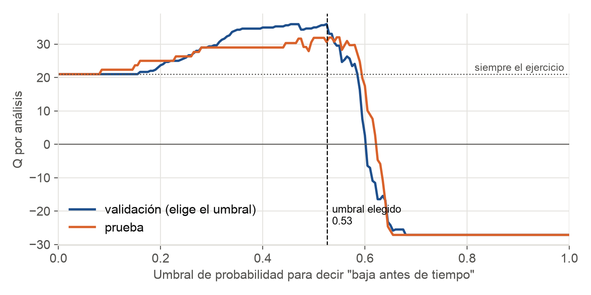
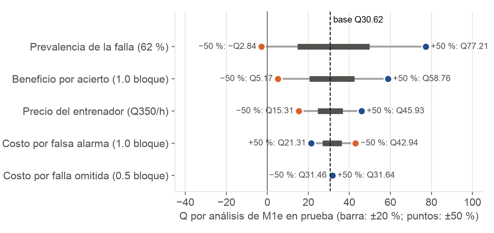
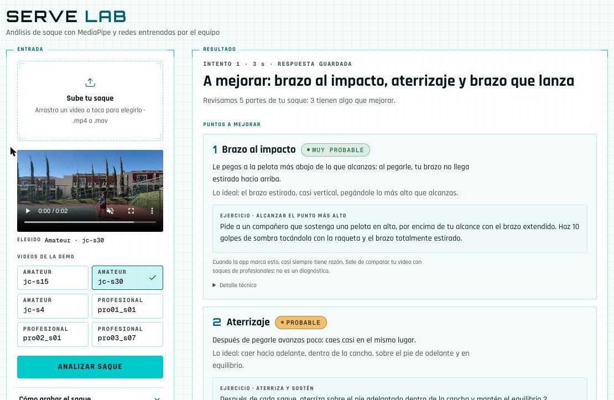

<!-- PDF ("Serve Lab - Trabajo Escrito.pdf" in the repository root, 4 pages), from the repository root:
pandoc docs/trabajo-escrito.md -s --embed-resources --resource-path=docs:. --css docs/informe.css --metadata pagetitle="Serve Lab: trabajo escrito del Proyecto Final" -o /tmp/trabajo-escrito.html
"/Applications/Brave Browser.app/Contents/MacOS/Brave Browser" --headless --no-pdf-header-footer --print-to-pdf="Serve Lab - Trabajo Escrito.pdf" /tmp/trabajo-escrito.html
-->

Universidad del Valle de Guatemala

Facultad de Ingeniería

CC3092 Deep Learning y Sistemas Inteligentes

Proyecto Final: caso de uso real

Serve Lab: cuánto vale detectar a tiempo una falla del saque de tenis

Ernesto David Ascencio Ramírez, 23009

Hugo Daniel Barillas Ajín, 23556

<a href="https://github.com/erneram/tennis-ai/tree/proyecto-final">github.com/erneram/tennis-ai</a>, rama <code>proyecto-final</code>

## Resumen

Serve Lab recibe el video de un saque de tenis grabado de lado con un teléfono y devuelve hasta tres puntos a mejorar, cada uno con un ejercicio y su confianza. El núcleo es M1e, una red convolucional temporal de 6,497 pesos entrenada por el equipo sobre la pose de MediaPipe, que decide si el brazo que lanza la pelota baja antes de tiempo. M1e vale Q30.62 por análisis en prueba (IC 95 %: Q20.37 a Q41.11), Q367 al mes por jugador, frente a Q15.91 del sistema del Proyecto 3 (Qwen3-VL-4B), que tarda 49 s en vez de 5 s. La mayor limitación es de datos: todas las fallas son de un mismo jugador.

## 4.1 Contexto de negocio y definición del problema

**Usuario y alternativa actual.** Un jugador amateur adulto que entrena solo y puede grabarse con su teléfono. Hoy la alternativa es una clase privada: las academias consultadas (8 nov 2026) cobran Q200 a Q500 por hora, así que 15 minutos de ejercicio guiado valen Q87.50 con el punto medio. La falla elegida es común (Kovacs y Ellenbecker, 2011): el brazo que lanza baja antes de tiempo, mientras la raqueta aún va hacia atrás. Su ejercicio es sostener el brazo arriba hasta el golpe, 3 series de 8 saques.

**Por qué deep learning.** Una regla fija (B0: falla si la muñeca que lanza baja del hombro más de 0.133 s antes del contacto) separa jugadores y no la falla: en JC la mediana es 0.17 s con y sin ella. Qwen3-VL-4B sin entrenar (versión A, Proyecto 3) tarda 49 s y ordena la falla con AUROC 0.646. Una red pequeña sobre la pose aprende la forma del movimiento y se transfiere: M1e llama falla a 2 % de los saques de un amateur nuevo (B0, 13 %) y a ninguno de los profesionales nuevos.

**KPIs y línea base.** El KPI es el valor por análisis en quetzales; detrás están el recall, las falsas alarmas, los videos que piden otra grabación y la latencia. Recomendar siempre el ejercicio vale Q21.00; nunca, −Q27.13; B0, Q28.43; el Proyecto 3, Q15.91.

## 4.2 Datos y análisis exploratorio

- **Fuentes.** 44 saques de JC, amateur intermedio, de lado a 60 fps, y 11 de tres profesionales (pro01 a pro03). El 7 de noviembre, 54 de EA (principiante) y 44 de JC después de la retroalimentación, nunca usados para entrenar. THETIS (Gourgari et al., 2013; 495 saques de frente) para preentrenar M2 y medir el sesgo por ángulo. Videos públicos solo para evaluación local.
- **Etiquetas.** Dos evaluadores con guía escrita: kappa 1.00 en qué se puede evaluar y 0.50 en la categoría, con los desacuerdos resueltos juntos. Se evalúan 48 de 55 videos: JC tiene 23 con la falla y 14 sin ella; los profesionales, 11 sin ella.
- **EDA.** Clases casi balanceadas (23 contra 25), pero todas las fallas son de JC: el riesgo principal es que el modelo reconozca al jugador. JC graba a 60 fps y casi todos los profesionales a 30 fps, así que todo se lleva a 30 fps y a coordenadas del cuerpo. MediaPipe ve 90 % de los puntos de los brazos de JC; con menos de 70 % la app pide otra grabación.
- **Preprocesamiento.** MediaPipe Pose (heavy) da 33 puntos; se usan 17. Se corta una ventana de 64 cuadros a 30 fps alrededor del contacto, centrada en la cadera y medida en largos de torso. M1e usa solo la altura de cada codo y muñeca sobre su hombro: 4 números por cuadro.
- **División y privacidad.** Prueba: JC del 1 de noviembre y pro01 (18 videos, 13 con la falla). Entrenamiento: 30, con validación cruzada de 5 particiones; ninguna decisión mira la prueba. Los videos son datos personales: no entran a Git y la app procesa todo en la computadora del usuario.

## 4.3 Modelo de valor

Con *p* la proporción de saques con la falla, TPR y FPR las tasas en el umbral y *B* el precio de un bloque de ejercicio:

valor = *B* × [ *p* × TPR × acierto − *p* × (1 − TPR) × omisión − (1 − *p*) × FPR × falsa alarma ] − cómputo

| Parámetro | Valor | Fuente |
|---|---|---|
| Proporción con la falla, *p* | 0.62 | 23 de los 37 saques evaluables de JC |
| Bloque, *B* | 15 min = Q87.50 | Q350 por hora, punto medio de Q200 a Q500; 3 series de 8 saques |
| Acierto / omisión / falsa alarma | 1.0 / 0.5 / 1.0 bloques | Estimación |
| Análisis al mes; cómputo | 12; 5.0 s a 50 W | Estimación; tiempo medido |

- **Vínculo con la métrica técnica.** Cada 0.10 más de recall vale Q8.14 por análisis; cada 0.10 menos de falsas alarmas, Q3.33. De los Q23.63 que separan a M1e de un modelo perfecto, Q18.62 son falsas alarmas.
- **Umbral.** Se elige donde el valor en validación es máximo (0.53), no en 0.5 ni por F1 (figura 1).
- **Sensibilidad.** Domina *p*: con 31 % M1e vale −Q2.84, y entre amateurs sin retroalimentación fue 25 %. El precio del entrenador escala el valor (Q15.31 a Q45.93) sin cambiar el umbral (figura 2). Un primer dato apoya el acierto: tras una sesión con la app, JC cerró 47 % de la distancia a los profesionales.

<figure><figcaption>Figura 1. Valor de M1e según el umbral, en validación y en prueba.</figcaption></figure>
<figure><figcaption>Figura 2. Sensibilidad del valor: barra ±20 %, puntos ±50 %.</figcaption></figure>

## 4.4 Metodología de desarrollo

- **Arquitectura.** CNN temporal: dos convoluciones 1D (kernel 5, 32 canales; la segunda con dilatación 2), ReLU, dropout 0.3, máximo global en el tiempo y una capa lineal. Se compararon Qwen3-VL-4B, descartado por latencia y porque no se entrena con 30 videos, y M2, el mismo par de convoluciones preentrenado en THETIS como autocodificador con máscara.
- **Pérdida y optimización.** Entropía cruzada binaria con peso por clase; el costo de negocio entra en el umbral, no en la pérdida. AdamW (10⁻³, decaimiento 10⁻²), aumento de datos, 5 semillas y 85 épocas, donde la pérdida de validación es mínima. Cada iteración cambia una cosa y se adopta con una regla escrita antes de entrenar.
- **Costo.** MediaPipe, preentrenado y congelado, tarda 5.0 s por video en CPU. Entrenar M1e completo toma 15 s en una Mac con Apple M5 Pro, sin GPU; la red infiere en 0.7 ms.

## 4.5 Resultados de iteraciones

**Tabla 1.** AUROC con media ± desviación en 5 semillas; valor con el umbral de validación e IC de 95 % en prueba. M1 usa 17 puntos; M1b, solo brazos; M1c, M1b a 85 épocas; M2c, M2 a 58 épocas; M1d y M1f suman 44 saques de JC después (*validación no comparable); M1e usa 4 alturas; M1g suma fallas sintéticas.

| Modelo | AUROC entren. | AUROC valid. | AUROC prueba | F1 prueba | Q valid. | Q prueba (IC 95 %) |
|---|---|---|---|---|---|---|
| A: Qwen3-VL | no aplica | 0.650 | 0.646 | 0.625 | 26.16 | 15.91 (−9.52 a 41.34) |
| B0: regla | no aplica | 0.608 | 0.800 | 0.723 | 24.50 | 28.43 (8.48 a 47.99) |
| M1 | 0.983 | 0.706 ± 0.044 | 0.532 ± 0.057 | 0.482 | 22.99 | 21.00 (21.00 a 21.00) |
| M1b | 1.000 | 0.721 ± 0.042 | 0.880 ± 0.034 | 0.682 | 27.49 | 29.14 (16.45 a 42.44) |
| M1c | 0.929 | 0.681 ± 0.063 | 0.757 ± 0.023 | 0.611 | 32.04 | 32.97 (21.00 a 46.27) |
| M2 | 1.000 | 0.673 ± 0.036 | 0.702 ± 0.033 | 0.700 | 29.12 | 34.30 (21.00 a 47.60) |
| M2c | 0.921 | 0.644 ± 0.031 | 0.618 ± 0.038 | 0.718 | 35.63 | 32.97 (21.00 a 46.27) |
| M1d | 0.932 | 0.858 ± 0.022* | 0.689 ± 0.020 | 0.546 | 43.17* | 10.51 (−12.80 a 32.58) |
| **M1e** | 0.919 | 0.790 ± 0.065 | 0.895 ± 0.043 | 0.695 | 36.00 | 30.62 (20.37 a 41.11) |
| M1f | 0.950 | 0.869 ± 0.038* | 0.905 ± 0.065 | 0.664 | 31.98* | 25.77 (15.36 a 36.10) |
| M1g | 0.798 | 0.742 ± 0.061 | 0.822 ± 0.102 | 0.769 | 36.96 | 30.47 (18.96 a 42.28) |

- **Sobreajuste.** M1 y M1b llegan a AUROC 0.98 y 1.00 en entrenamiento. Se redujo la entrada (de 13,377 a 6,497 pesos) y se detuvo en 85 épocas.
- **Atajo por jugador.** M1d sube la validación pero vale Q10.51 en prueba: aprendió la sesión, no la falla. Lo resolvió la entrada de M1e, que no dice dónde está el jugador ni cómo se grabó. M1g, con datos sintéticos, ordena al azar dentro de JC y se rechazó.
- **Inestabilidad.** Con 18 videos de prueba el F1 de M1e varía ±0.157 entre semillas y los intervalos se traslapan; por eso se elige con la regla fijada antes.

## 4.6 Despliegue y experiencia de usuario

**Arquitectura y operación.** Backend FastAPI y página React, todo en `http://127.0.0.1:7860`: el video no sale de la computadora (figura 3). Tarda 3 a 6 s por saque, unos 12 saques por minuto, y cuesta Q0.00014 por predicción en CPU.

<figure><figcaption>Figura 3. Resultado de la app para un saque de JC del conjunto de prueba.</figcaption></figure>

**Experiencia.** Cada falsa alarma son 15 minutos de ejercicio innecesario: con FPR 0.56, un jugador de 12 saques al mes pierde unos 38 minutos, y cada 0.10 menos le devuelve 7. Dar hasta tres puntos en vez de uno subió la precisión de 0.20 a 0.76 en validación. Con menos de 70 % de puntos vistos o la cámara de frente, la app pide otra grabación en vez de adivinar. Cada punto dice "Muy probable", "Probable" o "En duda" según su precisión en validación.

**Monitoreo.** Sin guardar el video, se registran latencia, rechazos y probabilidades; se revisa si los rechazos pasan de 20 % en una semana, y cada mes un entrenador etiqueta 20 saques: si la precisión de un punto baja de 0.70, pasa a "En duda" y se reentrena.

## 4.7 Explicabilidad, ética y riesgos

**Explicabilidad.** La oclusión y los gradientes integrados (Laboratorio 10) coinciden: M1e se apoya en la muñeca que lanza entre 0.53 y 0.2 s antes del contacto, lo que mira un entrenador, y solo 3 % a 9 % de la atribución cae después del contacto. También mostraron un proxy: el brazo de la raqueta empuja hacia la falla en todos los saques de JC, porque todas las fallas de entrenamiento son suyas.

**Sesgos** (`eval/bias.py`). M1e llama falla a 2 % de los saques de EA y a 0 % de 18 de profesionales nuevos, pero a 89 % de los saques limpios de JC. Con la cámara de frente (THETIS) todos los modelos fallan, y la app pide otra grabación en 79 % de esos casos. Reflejar el saque de un zurdo no cambia la probabilidad. **Uso indebido:** no debe usarse para calificar jugadores ni en decisiones médicas, y no se validó con menores.

## 4.8 Discusión y conclusiones

- **Quitar entrada valió más que agregar modelo.** Pasar a los brazos subió el valor en prueba de Q21.00 a Q29.14, y pasar a cuatro alturas bajó las falsas alarmas en un amateur nuevo de 80 % a 2 %.
- **AUROC y valor no coinciden.** M1b tiene AUROC 0.880 y vale Q29.14; M2, 0.702 y Q34.30. Cuenta la tasa en el umbral.
- **Rendimientos decrecientes.** M1e captura 29 % del valor entre no tener modelo y uno perfecto, y el intervalo de ±Q10 ya no distingue las mejores iteraciones: grabar amateurs con y sin la falla vale más que otra arquitectura.
- **Complejidad y viabilidad.** 4 mil millones de parámetros, 49 s y Q15.91 contra 6,497 pesos, 5 s y Q30.62. Corre en CPU y sin conexión; una suscripción de Q35 a Q50 al mes parece viable, pero es una hipótesis. Límites: dos amateurs, todas las fallas de uno y 18 videos de prueba.

## 4.9 Repositorio de GitHub

<https://github.com/erneram/tennis-ai>, rama `proyecto-final`: preprocesamiento (`core/pose/`, `strokes/serve/dataset.py`), entrenamiento (`strokes/serve/train.py`), evaluación y modelo de valor (`eval/`, `configs/value.yaml`), la app (`app/`, `web/`) y un README con los comandos que reproducen cada número. El video de demostración es `Serve Lab - Demo.mp4`.

## Referencias

- Kovacs, M. y Ellenbecker, T. (2011). An 8-stage model for evaluating the tennis serve. *Sports Health*, 3(6), 504-513.
- Gourgari, S. et al. (2013). THETIS: Three Dimensional Tennis Shots, a human action dataset. *CVPR Workshops*.
- Bazarevsky, V. et al. (2020). BlazePose: On-device real-time body pose tracking. *CVPR Workshops*.
